# Task 1.1: Data understanding, EDA, cleaning and augmentation

Dataset: **CUB-200-2011 with captions** (Hugging Face `Multimodal-Fatima/CUB_train` and `Multimodal-Fatima/CUB_test`).
Every number below comes from `outputs/eda/summary.json` and the tables in `outputs/eda/tables/`. To reproduce them:

```bash
pip install -r requirements.txt
python -m src.data.eda --out outputs/eda --fetch-cub-meta
```

`--fetch-cub-meta` downloads five small text files from the official CUB release into `data/CUB_200_2011/`
(the bounding boxes and the official split). It streams the 1.1 GB archive once and keeps only those files.
Without them, everything runs except the bounding-box analysis and the official-split check.
The first run decodes all 11,788 images and caches the per-image statistics, which takes a few minutes; later runs take seconds.

All choices that affect training (normalization, vocabulary, `min_freq`, augmentation evidence) are computed on the
**training split only**. The test set is never used to make a decision. Normalization and the vocabulary use the exact
training partition the models train on (`configs/split_indices.json` minus the exclusions in `configs/data.yaml`), so
validation images do not influence them either.

The EDA loads the data with the same pipeline code the models use (`src/data/dataset.py`, `src/data/splitting.py`,
`src/data/captions.py`), at the Hugging Face revisions pinned in `configs/data.yaml`. Its own per-image statistics are
still computed on the raw, unaugmented files.

---

## 1. Load and inspect

| Check | Result |
|---|---|
| Rows | 5,994 train / 5,794 test, 5 columns: `image`, `description`, `label`, `file_name`, `id` |
| Classes | 200 (`label` is a ClassLabel); the same 200 names in both splits |
| `id` column | Just the row number inside each split (0 to n-1), so it cannot be used to check for leakage. `file_name` is the real key |
| File names in both train and test | 0 |
| Label vs species in the file name | 0 mismatches |
| Split and labels vs the official CUB release | 0 differences for all 11,788 images |

**Decision:** the Hugging Face split is the official CUB split, so test results can be compared with published results.

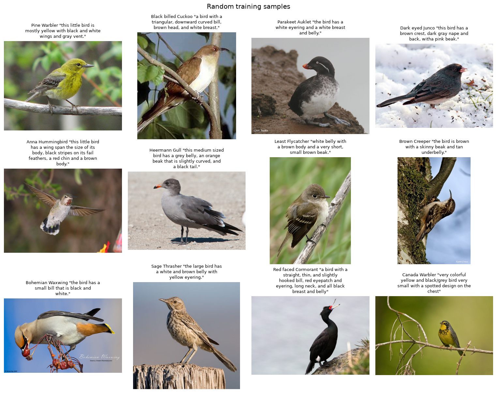

## 2. Class distribution

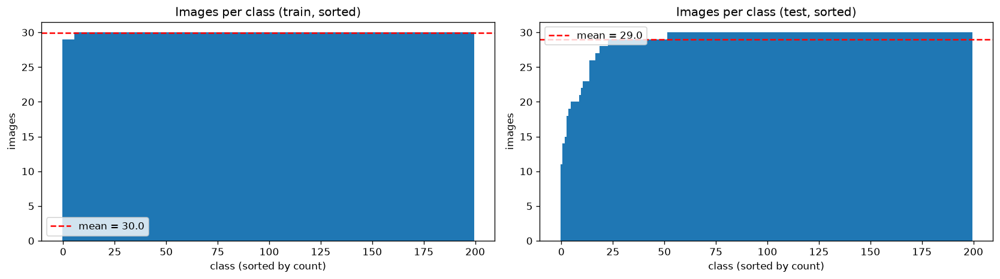

| | Train | Test |
|---|---|---|
| Images per class | 29–30 (194 classes have 30, 6 have 29) | 11–30 (mean 29.0) |
| Max / min ratio | 1.03 | 2.73 |
| Smallest classes | — | Least Auklet 11, Crested Auklet 14, Spotted Catbird 15, Rhinoceros Auklet 18, Whip poor Will 19 |

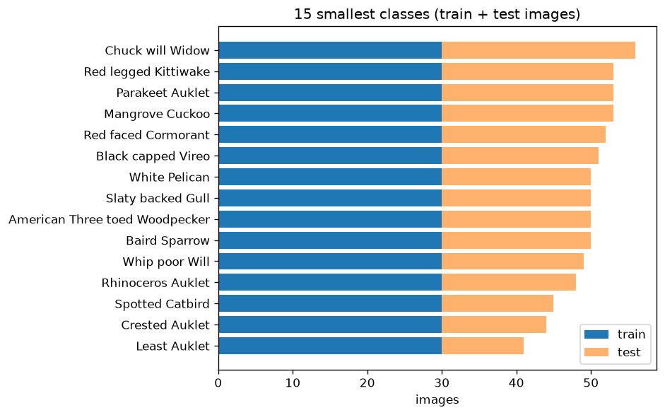

**Decisions:**
- Training data is balanced, so we use no class weights and no oversampling.
- The test set is imbalanced. Plain accuracy gives more weight to classes with more test images, so we report **macro-F1** alongside accuracy.
- Validation is a **stratified 10% split of train** (fixed seed), and the test set stays untouched. That gives about 600 images, only 2–3 per class, so per-class validation scores are noise. Validation is used for overall accuracy and macro-F1 only.
  The split is saved in `configs/split_indices.json`; after the leakage exclusions (Section 4) the models use
  5,393 training images (26–27 per class) and 598 validation images (2–3 per class).

## 3. Images

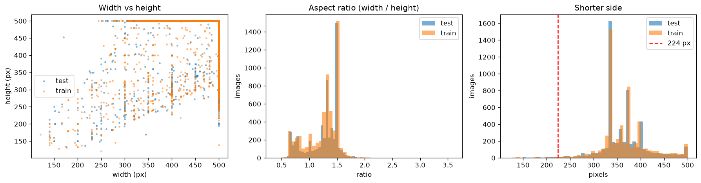

| Property | Result |
|---|---|
| Decode errors | 0; all files are JPEG |
| Modes | 11,780 RGB, **8 single-channel (L)** (4 train, 4 test) |
| Size | Width median 500 px, height median 375 px; the longer side is almost always 500 px |
| Aspect ratio | Median 4:3; 77% landscape, 20% portrait, 3% square |
| Shorter side | Median 357 px; **148 images (1.3%) are below 224 px** |

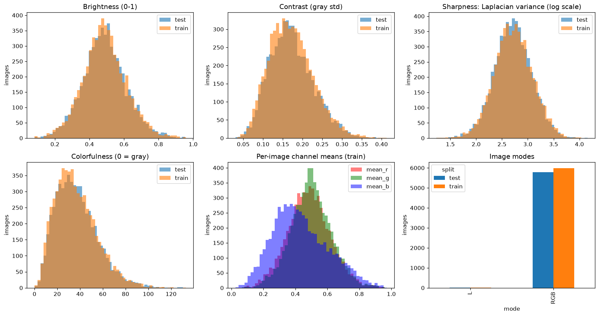

| Statistic (what it measures) | Median | Range |
|---|---|---|
| Brightness: mean gray level, 0–1 | 0.48 | 0.08–0.96 |
| Contrast: standard deviation of the gray level | 0.17 | 0.03–0.41 |
| Sharpness: variance of the Laplacian; low = few edges = blurry | 517 | 16–14,362 |
| Colorfulness (Hasler & Süsstrunk): spread and strength of color; 0 = gray | 34 | 0–133 |

**Grayscale images.** 9 images are truly black-and-white (5 train, 4 test): the 8 single-channel files, plus one RGB file
whose three channels are identical (California Gull, train #1743). They are listed in `tables/grayscale_images.csv`.
An image counts as grayscale when no pixel has more than 10 levels (out of 255) between its largest and smallest channel.
Section 7 explains why this replaced the original check.

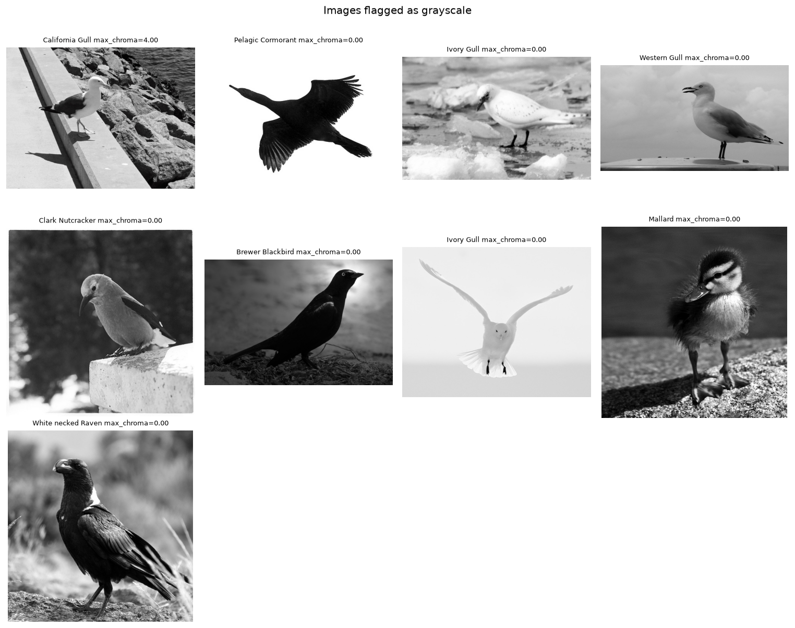

**Low-quality images.** We looked at the blurriest, darkest, least colorful and smallest images
(`figures/03_examples_*.png`). The birds stay identifiable in all of them, so they are real variation that the model has
to handle at test time, and we keep them.

**Normalization** (computed on train only, at 256×256):

| | Mean (R, G, B) | Std (R, G, B) |
|---|---|---|
| CUB train, all 5,994 images | 0.4856, 0.4994, 0.4324 | 0.2272, 0.2226, 0.2613 |
| **CUB training partition, 5,393 images (used by the pipeline)** | **0.4849, 0.4990, 0.4324** | **0.2271, 0.2225, 0.2613** |
| ImageNet | 0.485, 0.456, 0.406 | 0.229, 0.224, 0.225 |

Green is higher and blue lower than ImageNet, which fits outdoor photos full of foliage.

**Decisions:**
- Call `.convert("RGB")` on every image.
- Keep the 9 grayscale images for classification and **exclude them from colorization** (listed under
  `colorization_exclude` in `configs/data.yaml`).
- Normalize the scratch CNN with the CUB statistics of the training partition (`CNN_MEAN`/`CNN_STD` in
  `src/data/transforms.py`), and ResNet18 with the ImageNet statistics it was pretrained with.
- Keep low-quality images. Upsampling the 148 small images to 224 px is fine.

## 4. Data quality

| Check | Result |
|---|---|
| Decode errors | 0 |
| Missing labels, file names or descriptions | 0 |
| Exact duplicates (identical file bytes) | 1 pair: Pigeon Guillemot train #1712 = #1731 |
| Near-duplicates (dHash; candidate pairs at ≤2 / ≤4 / ≤6 bits) | 8 / 8 / 12 |
| Candidates checked by eye at ≤6 bits | **9 real duplicates, 3 false positives** |

A **difference hash** (dHash) shrinks an image to 9×8 gray pixels and records whether each pixel is brighter than its
right-hand neighbour. That gives 64 bits that describe the layout of the image and barely change when the image is resized
or recompressed. The **Hamming distance** counts the bits that differ between two hashes; for all pairs at once it is
computed as |a| + |b| − 2·a·b. Different birds photographed the same way, for example small and centered on a plain
background, can also hash alike, so every candidate pair was checked by eye. The verdicts are kept in
`configs/eda/near_duplicate_review.csv` and shown on the figure. A distance of 6 bits is used because 4 bits misses a
real train/test duplicate (the Marsh Wren pair, at distance 6).

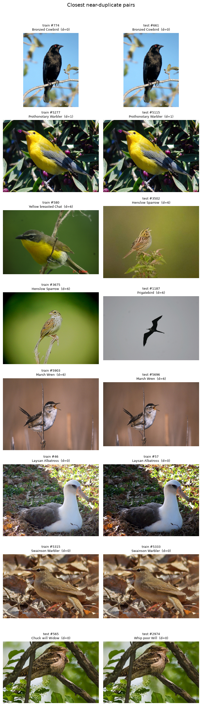

| Finding | Pairs | Decision |
|---|---|---|
| **Train/test leakage** | Bronzed Cowbird train #774 / test #661, Prothonotary Warbler train #5277 / test #5115, Marsh Wren train #5903 / test #5696 | **Drop the 3 train copies** (`tables/leakage_train_to_drop.csv`, applied from `exclusions.train_leakage` in `configs/data.yaml`). The saved split had put #774 and #5277 in validation and #5903 in train; they are removed after the split is loaded, so validation would otherwise have contained 2 test photos. Never drop the test copy, so the test set stays the same as in published work |
| Same photo with two labels | Chuck will Widow test #565 = Whip poor Will test #2974 | At least one label is wrong. Both are in test, so we leave them and report it as label noise |
| Duplicates within train | Pigeon Guillemot (exact), Laysan Albatross #46/#57, Swainson Warbler #5315/#5333 | Optional: keep one copy of each |
| Duplicates within test | Red legged Kittiwake, Brewer Sparrow, Summer Tanager | Leave as they are |

**Overlap with ImageNet.** The CUB homepage warns: *"Images in this dataset overlap with images in ImageNet. Exercise
caution when using networks pretrained with ImageNet (or any network pretrained with images from Flickr) as the test set
of CUB may overlap with the training set of the original network."* So an ImageNet-pretrained ResNet18 may already have
seen some CUB test birds. This can inflate transfer-learning accuracy, and the benchmark discussion has to say so.

## 5. Captions

| Check | Result |
|---|---|
| Captions per image | Exactly 10 for all 11,788 images |
| Empty lines | 1 per image, from a trailing `\n` |
| Length (train, after cleaning) | Median 14 tokens; 90th percentile 21, 95th 24, 99th 32; max 66 |
| Duplicate captions within an image | 1,312, spread over 1,189 images; after removing them every image keeps 7–10 captions |
| Template captions across images | For example, "this bird has wings that are brown and has a white belly" appears 601 times; 1,606 distinct train captions are used more than once |
| Broken spaces | 56 captions have every space replaced by a pair of U+FFFD characters (1,700 characters in total) |
| Junk captions | 3 captions of 1–3 tokens ("this", "the colorful bird") |
| Characters removed by cleaning | Mostly `,` (103k), `.` (93k), `-` (3.8k), `'` (3.3k) |

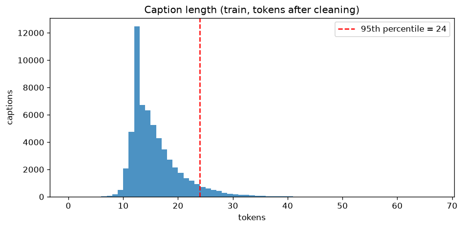

**Vocabulary.** The vocabulary is built from train only. To choose `min_freq` without touching test, we count words in
the model-ready captions (`clean_captions`, steps 1–3 below) of the **training partition** and measure how many tokens of
the **validation partition** would become `<unk>`. Both partitions come from the canonical split manifest, so this is
the vocabulary the decoder will actually get. The split is by image, because the 10 captions of one image are
near-paraphrases.

| min_freq | Words kept | Train tokens covered | Validation tokens that become `<unk>` |
|---|---|---|---|
| 1 | 3,882 | 100% | 0.20% |
| 2 | 2,113 | 99.78% | 0.30% |
| 3 | 1,564 | 99.65% | 0.39% |
| **5** | **1,186** | **99.49%** | **0.54%** |
| 10 | 842 | 99.22% | 0.81% |
| 20 | 577 | 98.77% | 1.22% |

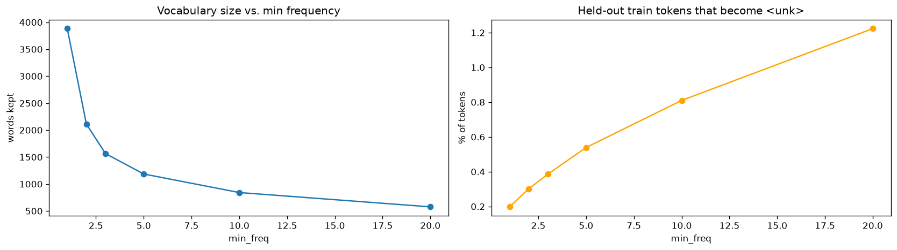

**Typos.** We flagged rare words (seen at most twice) that are one edit away from a common word (Norvig's edit distance):
744 candidates, listed in `tables/typo_candidates.csv`. Most are real typos ("brast", "witrh", "blakc"), but many are real
words that happen to be one letter away from a common one ("true"→"tree", "nail"→"tail", "seal"→"teal"). Correcting them
automatically would damage real words. Because every candidate is rare, `min_freq` turns the real typos into `<unk>` anyway.

**Spelling variants.** "grey" appears 10,563 times and "gray" 6,953 times: one color split over two tokens (see the color-word chart).

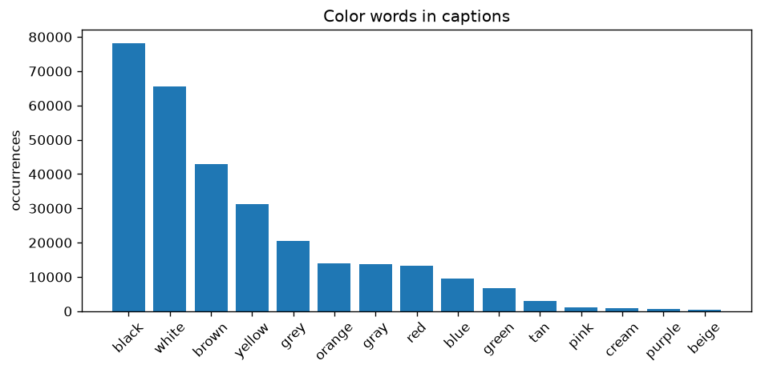

**Decisions (caption preprocessing, in order):**
1. Split `description` on `\n`, strip each line, and drop empty lines.
2. Lowercase; remove apostrophes ("bird's" → "birds"); replace every other character outside `[a-z0-9 ]` with a space (this also repairs the 56 broken captions); collapse repeated spaces.
3. Drop exact duplicate captions within an image, and captions with fewer than 4 tokens.
4. Optional: map "grey" → "gray". If we do, apply it to the evaluation references too.
5. Build the vocabulary from the training partition with **`min_freq = 5`** (1,186 words + `<pad>`, `<start>`, `<end>`, `<unk>`). Words seen 3–4 times are too rare for a decoder to learn and still include typos ("thraot", "eblly").
6. **`max_len = 26`**: the 95th percentile (24) plus `<start>` and `<end>`. About 5% of captions are truncated. On the model-ready captions of the training partition the 95th percentile is 25, because 5.03% of them are longer than 24 tokens (4.99% over the whole train split); `max_len = 26` still truncates about 5%, so it is kept.
7. Do not correct typos.

Steps 1–3 are `clean_captions()` in `src/data/captions.py`; the raw `description` is never modified. Over all
11,788 images they turn 117,880 raw captions into 116,565: 3 are dropped for having fewer than 4 tokens and 1,312 as
repeats within an image, leaving 7–10 captions per image. Steps 5–6 are `build_vocabulary()`, `MIN_FREQ` and `MAX_LEN`
in the same module.

Template captions are a risk for Milestone 2: a decoder can score well on BLEU by repeating generic templates.
Generated captions should therefore be read by a person as well as scored.

## 6. Augmentation

The official bounding boxes show how much of each training image the bird fills: a median of **32%** (5th percentile 11%,
95th percentile 69%), and under 10% in 3.4% of images. We simulated torchvision's `RandomResizedCrop` sampling
(10 crops per training image) and measured how much of the bird each crop keeps:

| Crop scale lower bound | Bird visible, on average | Crops with less than half the bird |
|---|---|---|
| 0.08 (torchvision default) | 64% | **33%** |
| 0.25 | 76% | 15% |
| 0.4 | 84% | 4.1% |
| **0.6** | **93%** | **0.22%** |
| 0.8 | 99% | 0% |

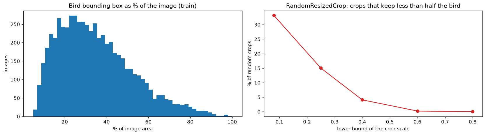

For validation and test, the center crop was compared the same way:

| Validation/test transform | Bird visible, on average | Whole bird inside | Less than half the bird |
|---|---|---|---|
| `Resize(256)` + `CenterCrop(224)` | 89% | 33% of images | 0.2% |
| **`Resize(224)` + `CenterCrop(224)`** | **94%** | **54% of images** | **0.03%** |

Evidence from the captions (train only):
- **0.04%** of captions mention left or right, so a horizontal flip does not contradict them.
- **97.6%** of captions name a color, so color describes the species.

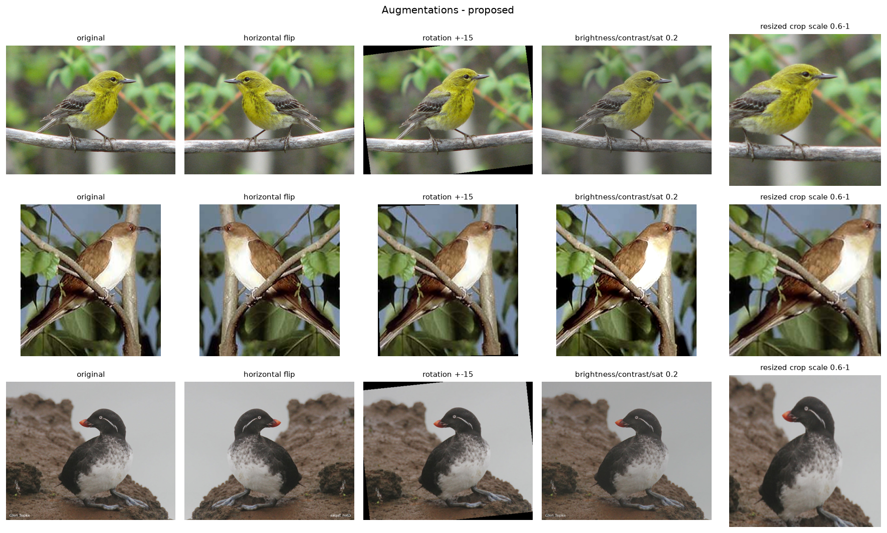
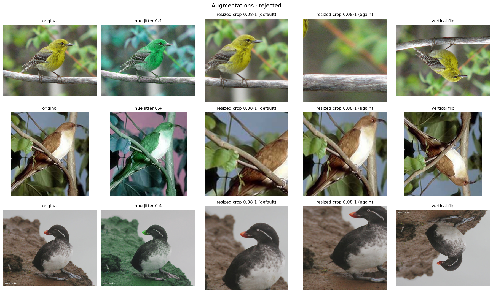

**Decisions:**

| Augmentation | Decision | Why |
|---|---|---|
| `RandomResizedCrop(224, scale=(0.6, 1.0))` | Use | At 0.6 only 0.22% of crops lose more than half the bird; at the default 0.08, 33% do, and some crops show only a branch |
| `RandomHorizontalFlip()` | Use | Birds look the same mirrored; only 0.04% of captions mention left or right |
| `RandomRotation(15)` | Use | Small tilts of camera or perch. Rotation leaves black corners, so the angle stays small |
| `ColorJitter(brightness=0.2, contrast=0.2, saturation=0.2)` | Use | Lighting varies a lot between photos (brightness 0.08–0.96) |
| Hue jitter | **Reject** | A hue shift turns a yellow warbler green, which makes it look like another species, contradicts the captions (97.6% name a color), and corrupts colorization targets |
| Vertical flip | **Reject** | Upside-down birds never occur in the data |
| Validation/test | `Resize(224)` + `CenterCrop(224)` + normalize | No augmentation: evaluation must use real, unmodified images |

## 7. What did not work, and what we changed

1. **Grayscale check, first version.** The original script flagged an image as gray when its *mean* difference between
   color channels was below 2.0. That flagged 70 images, but most were color photos of gray birds on a large gray sky or
   sea: the red legs of a kittiwake or the crest of a woodpecker barely move a mean over the whole image. Lowering the
   threshold to 0.1 fixed those, but it still flagged a black-and-white Mockingbird photo with a hand-colored orange eye
   (0.09% of its pixels), because its mean was even lower than that of a fully gray photo. That photo has real color, so it
   should be colorized. **Fix:** test the most colorful pixel instead of the mean (`max_chroma`). Gray photos score 0–4,
   the Mockingbird scores 105, and the least colorful real photos start at 11.
2. **A stale figure.** When a run found no grayscale images, the plotting helper returned without touching the file, and
   the grid from the previous run stayed on disk looking current. **Fix:** delete the file when there is nothing to plot.
3. **Near-duplicate threshold.** The default of 4 bits missed a real train/test duplicate at 6 bits. At 6 bits the figure
   showed false positives next to real duplicates with no way to tell them apart. **Fix:** a threshold of 6 bits plus a
   hand-written review file whose verdicts appear on the figure and in the tables.
4. **`min_freq` chosen on test.** The original script measured `<unk>` on test captions to choose `min_freq`, which lets
   test data influence a training choice. **Fix:** measure it on a held-out 10% of the train images. The augmentation
   evidence from captions was also moved to train only.
5. **Smallest-classes plot.** Ranking classes by training count was nearly arbitrary, because train has 29–30 images per
   class everywhere; the real shortfall is in test. **Fix:** rank by train + test.
6. **Center crop.** We first recommended `Resize(256)` + `CenterCrop(224)`, the ImageNet convention. The bounding-box
   analysis showed it cuts part of the bird in two thirds of images. **Fix:** `Resize(224)` + `CenterCrop(224)`.
7. **Shared ids.** All 5,794 test ids also appear in train, which looked like leakage until we saw that `id` is only the
   row number. The summary now records this, and leakage is checked with `file_name`.
8. **`min_freq` on a different split.** The held-out 10% used to choose `min_freq` was a random sample drawn by the EDA,
   not the validation partition the models use, and the vocabulary counted every train image. **Fix:** the table in
   Section 5 is recomputed on the canonical partitions, with the pipeline's own caption cleaning. The vocabulary at
   `min_freq = 5` shrinks from 1,241 to 1,186 words; the `<unk>` rate barely moves (0.58% → 0.54%), so `min_freq = 5`
   stays.

## 8. Summary: finding → evidence → recommendation

| # | Finding | Evidence | Recommendation | For |
|---|---|---|---|---|
| 1 | Hugging Face split = official CUB split | 0 split or label differences over 11,788 images | Results are comparable with published work | Member 6 |
| 2 | Train balanced, test imbalanced | Train 29–30 per class; test 11–30 | No class weights; report macro-F1 with accuracy | Members 3, 4, 6 |
| 3 | Validation must come from train | Test is reserved for final evaluation | Stratified 10% of train, fixed seed | Member 2 |
| 4 | 8 single-channel images | `modes` in the summary | `.convert("RGB")` when loading | Member 2 |
| 5 | 9 grayscale images | `tables/grayscale_images.csv` | Keep for classification, exclude from colorization | Member 2, Milestone 2 |
| 6 | Images are mostly 4:3; 1.3% under 224 px | Size histograms | Train: `RandomResizedCrop(224, scale=(0.6, 1))`; val/test: `Resize(224)` + `CenterCrop(224)` | Member 2 |
| 7 | CUB colors differ from ImageNet | Train mean and std | Scratch CNN: CUB train stats; ResNet18: ImageNet stats | Members 2, 3, 4 |
| 8 | 3 train images also in test | Checked by eye | Drop train #774, #5277, #5903 | Member 2 |
| 9 | One photo labeled as two species | Test #565 = #2974 | Report as label noise; leave test as is | Member 6 |
| 10 | CUB overlaps ImageNet | CUB homepage warning | Mention in the transfer-learning comparison and the benchmark | Members 4, 6 |
| 11 | Captions need cleaning | Trailing `\n`, 1,312 duplicates, 56 broken captions, 3 junk | The 7-step caption preprocessing in Section 5 | Member 2, Milestone 2 |
| 12 | Vocabulary and length | `min_freq` table; length percentiles | `min_freq = 5`, `max_len = 26`, vocabulary from train only | Milestone 2 |
| 13 | Color identifies the species | 97.6% of captions name a color; a hue shift changes the species | No hue jitter | Member 2 |
| 14 | Default crop loses the bird | 33% of crops keep less than half of it | Crop scale lower bound 0.6 | Member 2 |

## References

- C. Wah, S. Branson, P. Welinder, P. Perona, S. Belongie. *The Caltech-UCSD Birds-200-2011 Dataset.* Caltech Technical Report CNS-TR-2011-001, 2011. https://www.vision.caltech.edu/datasets/cub_200_2011/
- S. Reed, Z. Akata, H. Lee, B. Schiele. *Learning Deep Representations of Fine-Grained Visual Descriptions.* CVPR 2016 (the ten captions per image).
- D. Hasler, S. Süsstrunk. *Measuring Colourfulness in Natural Images.* Proc. SPIE 5007, 2003.
- J. L. Pech-Pacheco, G. Cristóbal, J. Chamorro-Martínez, J. Fernández-Valdivia. *Diatom Autofocusing in Brightfield Microscopy: a Comparative Study.* ICPR 2000 (variance of the Laplacian as a sharpness measure).
- N. Krawetz. *Kind of Like That.* The Hacker Factor Blog, 2013 (difference hash).
- P. Norvig. *How to Write a Spelling Corrector.* 2007 (one-edit candidates).
